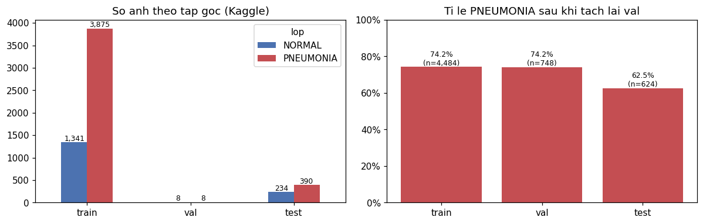
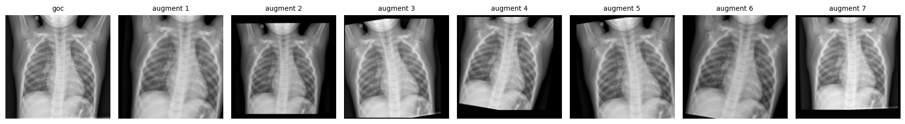
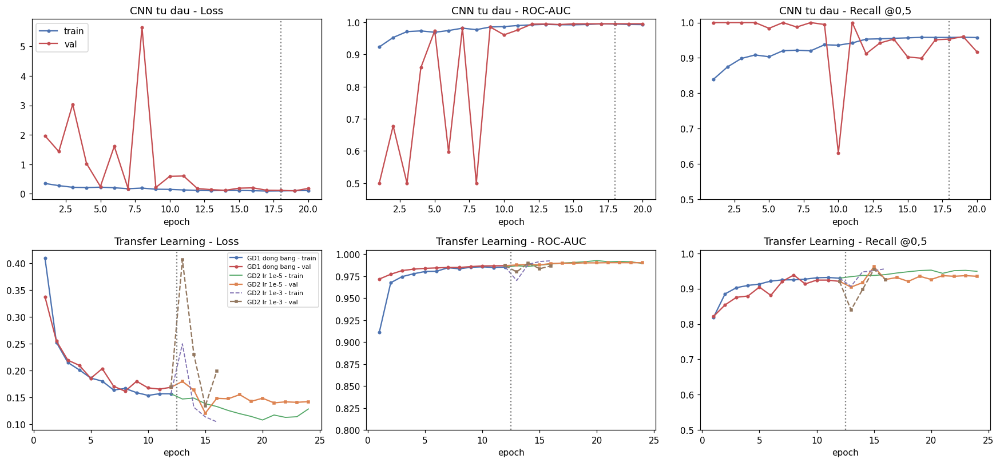
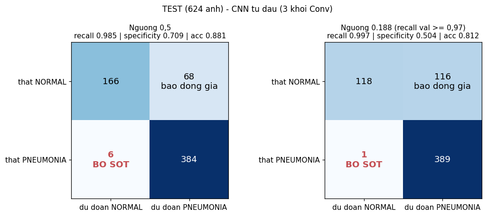
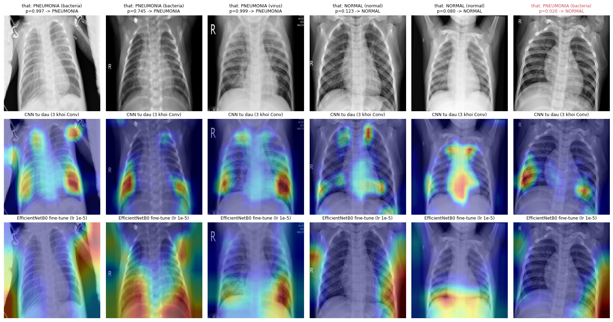
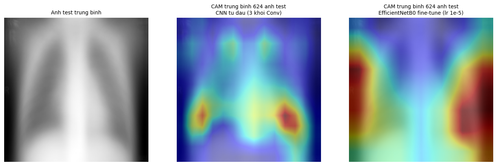
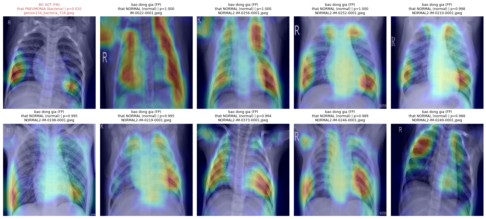

# TT-26 — CNN (CONVOLUTIONAL NEURAL NETWORK)
## Sàng lọc viêm phổi trên ảnh X-quang ngực — kết quả thực nghiệm

| | |
|---|---|
| 🎓 **Khoá** | HỌC MÁY · [Buổi 10](https://github.com/TruongTanNghia/Training-Machine-learning/tree/main/Buoi-10-CNN-ComputerVision) |
| 🧠 **Nhóm** | Deep Learning · Thị giác máy tính |
| 🔧 **Thuật toán** | CNN tự xây (3 khối Conv) · Transfer Learning + Fine-tuning EfficientNetB0 · Grad-CAM |
| 🏭 **Lĩnh vực** | Y tế · Chẩn đoán hình ảnh |
| 📊 **Dữ liệu** | [Chest X-Ray Images (Pneumonia)](https://www.kaggle.com/datasets/paultimothymooney/chest-xray-pneumonia): 5.856 phim của bệnh nhi 1–5 tuổi, NORMAL / PNEUMONIA |

> ## 🩺 CẢNH BÁO Y TẾ
> * Đây là công cụ **sắp thứ tự ưu tiên đọc phim**, **KHÔNG** phải công cụ chẩn đoán. Mọi phim, kể cả phim không bị
>   gắn cờ, đều phải có bác sĩ đọc lại.
> * Dữ liệu từ **một** bệnh viện ở Quảng Châu (Trung Quốc), trên **bệnh nhi 1–5 tuổi** → **không tổng quát hoá** cho
>   người lớn, máy chụp khác hay dân số khác.
> * Trên chính bộ dữ liệu này, specificity đã tụt từ 0,96 (val) xuống 0,50 (test) do lệch phân phối. Ở nơi triển khai
>   mới, **phải hiệu chỉnh lại ngưỡng** trên dữ liệu tại chỗ trước khi dùng.

> **Kết quả chính:**
> * ✅ **Recall test 0,997: bỏ sót 1 / 390 ca viêm phổi** (yêu cầu ≥ 0,96). Cái giá: 116 / 234 phim bình thường bị báo
>   động giả, accuracy 0,81.
> * **CNN tự xây train từ đầu thắng trên val** (AUC 0,9955 so với 0,9902 của fine-tune) và **hoà trên test** (0,958 /
>   0,957). Không overfit dù chỉ có 4.484 ảnh train. Kết quả này ngược với giả định của đề.
> * **Grad-CAM:** CNN tự xây nhìn vào **phế trường dưới hai bên**, không nhìn chữ/ký hiệu trên phim. EfficientNet nhìn
>   nhiều vào **thành ngực và bụng** (64% ảnh có điểm nóng ở viền). Hai model có AUC test bằng nhau nhưng chỉ một model
>   nhìn đúng chỗ.
> * Fine-tune lr 1e-5 > đóng băng. lr 1e-3 gây sốc (val loss ×2,4) nhưng không phá huỷ hẳn, vì BatchNorm bị khoá.

---

## 1. Dữ liệu: 3 vấn đề và cách xử lý



| Vấn đề | Số liệu | Cách xử lý |
|---|---|---|
| 1. **Val gốc 16 ảnh** (8 + 8) | 1 ảnh sai = recall đổi 12,5 điểm → chọn model theo nhiễu | Gộp vào train (5.232 ảnh) rồi **tự tách 1/7 ≈ 14,3%** bằng `StratifiedGroupKFold`: stratify theo nhãn **và nhóm theo bệnh nhân** (1 bệnh nhân có tới 31 phim) |
| 2. **Mất cân bằng** | Train 74,2% PNEUMONIA | `class_weight` balanced: NORMAL 1,94 · PNEUMONIA 0,67 |
| 3. **Train ≠ test** | Test 62,5% PNEUMONIA, và phim NORMAL test "khó" hơn | Không sửa được → đo và báo cáo (mục 4) |

| Tập | Số ảnh | NORMAL | PNEUMONIA | Bệnh nhân | Dùng để |
|---|---:|---:|---:|---:|---|
| train | 4.484 | 1.156 | 3.328 | 2.452 | fit |
| val (tự tách) | 748 | 193 | 555 | 409 | EarlyStopping, chọn model, chọn ngưỡng |
| test (gốc) | 624 | 234 | 390 | 427 | **chỉ báo cáo, 1 lần** |

Mã bệnh nhân lấy từ tên file (`person123_bacteria_4.jpeg` → `person123`). Chi tiết: [data/DATA_SOURCE.md](data/DATA_SOURCE.md).

**Pipeline:** 5.856 JPEG (rộng 384–2.916 px) → xám → 224×224 → cache `uint8` 294 MB → `tf.data` (lặp 3 kênh, batch 32).
Chuẩn hoá nằm **trong** model, nên file `.keras` tự đủ.

**Augmentation (chỉ train):** xoay ±10°, dịch ±10%, phóng to ±10%, độ sáng/tương phản ±10%.
**Không lật ngang:** tim nằm bên trái bệnh nhân, lật ngang tạo ra ảnh *dextrocardia* (tim bên phải), sai giải phẫu.
**Không lật dọc.**



## 2. So sánh: CNN từ đầu vs Transfer Learning vs Fine-tuning

| | Kiến trúc | Tham số train | lr | Epoch (tốt nhất) | Thời gian (CPU) |
|---|---|---:|---|---:|---:|
| CNN từ đầu | 3 khối [Conv-BN-ReLU ×2 → MaxPool], 32/64/128 bộ lọc → GAP → Dropout → Dense | 287.585 | 1e-3 | 20 (18) | 57 ph |
| TL giai đoạn 1 | EfficientNetB0 ImageNet **đóng băng** → GAP → Dropout(0,3) → Dense | 1.281 | 1e-3 | 12 (12) | 28 ph |
| TL giai đoạn 2 | Mở **30/238 lớp cuối** (block6d, block7a, top), **BatchNorm vẫn khoá** | 1.484.641 | **1e-5** | 12 (9) | 34 ph |
| *Đối chứng* | Như giai đoạn 2 nhưng lr 1e-3 | 1.484.641 | 1e-3 | 4 (2) | 6 ph |

Callback chung: `EarlyStopping(val_auc, restore_best_weights)`, `ReduceLROnPlateau(val_loss, ×0,3)`, `ModelCheckpoint`.
Theo dõi **AUC** chứ không phải recall, vì recall @0,5 = 1,0 khi model đoán tất cả là PNEUMONIA.



* **CNN từ đầu:** val **rất bất ổn** khi lr = 1e-3 (`val_auc` rơi về 0,50 ba lần, `val_loss` lên tới 5,65) do thống kê
  trượt của BatchNorm không theo kịp trọng số. Sau khi lr giảm (epoch 10+), val ổn định ở AUC 0,995. **Không overfit**:
  loss train 0,10 ≈ loss val 0,11.
* **Đóng băng:** mượt, epoch 1 đã đạt AUC 0,972, nhưng **trần thấp** (0,987). Đặc trưng ImageNet không phải đặc trưng
  tốt nhất cho phim X-quang xám.
* **Fine-tune lr 1e-5:** +0,003 AUC val, mượt. **lr 1e-3:** epoch đầu val loss 0,17 → **0,41**, recall val 0,92 → 0,84,
  rồi hồi phục và dao động. Không phá huỷ hẳn (chỉ mở 30 lớp, BN khoá) nhưng không ổn định.

## 3. Chọn model và ngưỡng (chỉ dùng val)

Ngưỡng = ngưỡng **cao nhất** còn giữ **recall val ≥ 0,97** (cao nhất = ít báo động giả nhất). Model = AUC val cao nhất.

| Mô hình | AUC val | Ngưỡng | Spec. val | AUC test | Recall test | **Bỏ sót** | Báo động giả | Acc. test |
|---|---:|---:|---:|---:|---:|---:|---:|---:|
| **CNN từ đầu** ← chọn | **0,9955** | 0,188 | **0,959** | **0,958** | **0,997** | **1** | 116 | 0,813 |
| EfficientNetB0 đóng băng | 0,9870 | 0,222 | 0,896 | 0,946 | 0,990 | 4 | 125 | 0,793 |
| EfficientNetB0 fine-tune | 0,9902 | 0,255 | 0,927 | 0,957 | 0,992 | 3 | **106** | **0,825** |
| *(đối chứng lr 1e-3)* | 0,9926 | 0,022 | 0,922 | 0,960 | 0,997 | 1 | 132 | 0,787 |

Đối chứng lr 1e-3 phải hạ ngưỡng xuống 0,02 mới đạt recall 0,97, dấu hiệu xác suất bị lệch mạnh. Nó không tham gia chọn.

## 4. Kết quả trên TEST: ma trận nhầm lẫn và số ca bỏ sót



| CNN từ đầu, 624 ảnh test | Recall | **BỎ SÓT** | Báo động giả | Specificity | Precision | Accuracy |
|---|---:|---:|---:|---:|---:|---:|
| Ngưỡng 0,5 | 0,985 | **6** | 68 | 0,709 | 0,850 | 0,881 |
| **Ngưỡng 0,188** (chọn trên val) | **0,997** | **1** | 116 | 0,504 | 0,770 | 0,813 |

* **Bỏ sót 1 / 390 ca** (`person154_bacteria_728.jpeg`). Viêm phổi do vi khuẩn: 241/242 được gắn cờ. Do virus: 148/148.
* Nghĩa thực tế: bác sĩ trực đọc trước **505 phim** được gắn cờ. Trong **119 phim** còn lại chỉ có 1 ca viêm phổi.
* Accuracy 0,81 **thấp hơn mức tham chiếu 0,88–0,93**. Ở ngưỡng 0,5 accuracy đạt 0,881 nhưng bỏ sót 6 ca. Đổi 5 ca
  bỏ sót lấy 48 báo động giả là đúng ưu tiên của bài toán.
* **Lệch phân phối (vấn đề 3) đo được:** xác suất PNEUMONIA trung vị của phim NORMAL là **0,002 ở val** nhưng **0,18 ở
  test**. Specificity tụt từ 0,96 xuống 0,50, và **cả 4 model** đều bị như nhau. Nhóm phim `NORMAL2-IM-*` (165/234 NORMAL
  test) bị báo động giả 53%, nhóm `IM-*` 41%.

## 5. ⭐ Grad-CAM: model có nhìn vào vùng phổi không?





Định lượng trên **cả 624 ảnh test**: "viền" = dải 12% mỗi cạnh (chỗ có chữ R, giờ chụp, mã máy `KV..`).

| | Năng lượng CAM ở viền (diện tích 42%) | Ở 4 góc (diện tích 5,8%) | % ảnh có đỉnh CAM ở viền |
|---|---:|---:|---:|
| **CNN từ đầu** | **25%** | **3,5%** | **21%** |
| EfficientNetB0 fine-tune | 50% | 6,3% | 64% |

* **CNN từ đầu nhìn đúng chỗ.** CAM trung bình tập trung ở **phế trường dưới hai bên**, ít hơn hẳn mức phân bố đều ở
  viền và góc. Phim viêm phổi: vùng nóng trùng vùng mờ trong phổi. Phim bình thường: vùng nóng ở trung thất/bóng tim.
  **Không ca nào sáng ở chữ "R", giờ chụp hay mã máy**, kể cả phim có in giờ và `KV68` ở góc → không có dấu hiệu
  "gian lận" bằng ký hiệu trên phim.
* **EfficientNet fine-tune đáng lo hơn:** CAM trung bình nằm ở **thành ngực hai bên và bụng**, ngoài phổi. Một phần do
  CAM của nó chỉ có 7×7 ô (rất thô), nhưng xu hướng rõ. Đây là lý do thứ hai để không chọn nó.

## 6. Phân tích 10 ca dự đoán sai



Tất cả ca bỏ sót (1) + 9 ca báo động giả mà model tự tin nhất (`reports/ca_du_doan_sai.csv`):

| Ca | Xác suất | Nguyên nhân |
|---|---:|---|
| **BỎ SÓT** `person154_bacteria_728` | 0,020 | Xem cả ảnh gốc: hai phế trường vẫn **đen, thông khí tốt**, không thấy đông đặc rõ, phim hơi xoay. Tổn thương có thể rất nhỏ, hoặc **nhãn nhiễu** |
| FP `IM-0022-0001` | 1,000 | Phim **xám đục toàn bộ, tương phản rất thấp** → trông như mờ lan toả |
| FP `NORMAL2-IM-*` ×8 | 0,988–1,000 | Đa số **mờ / tương phản thấp** hoặc **vân phổi đậm**. CAM ở phế trường dưới, tức đúng vùng, nhưng vùng đó trông "đục" giống thâm nhiễm |

→ Báo động giả do **chất lượng phim** (rất phổ biến ở trẻ 1–5 tuổi), không phải do đường tắt. Ca bỏ sót duy nhất không
có dấu hiệu rõ kể cả ở độ phân giải gốc.

## 7. Cạm bẫy: thực tế trong bài

| Cạm bẫy | Thực tế |
|---|---|
| Dùng val 16 ảnh của bộ gốc | Đã thay bằng val 748 ảnh, tách theo bệnh nhân |
| Lật ngang khi augment | Không dùng. Kiểm tra bằng mắt: chữ "R" và bóng tim giữ đúng phía (`reports/augmentation.png`) |
| Fine-tune với lr 1e-3 | Đã chạy đối chứng: val loss ×2,4 ngay epoch đầu, ngưỡng phải hạ về 0,02. Không phá huỷ hẳn nhờ khoá BN + chỉ mở 30 lớp |
| Train từ đầu với 5.000 ảnh → overfit | **Không xảy ra** với mạng 288k tham số + BN + augmentation + GAP. Vấn đề thật là val bất ổn khi lr lớn |
| Dùng accuracy làm metric chính | Accuracy cao nhất (0,881 @0,5) đi kèm 6 ca bỏ sót. Ngưỡng đúng cho 1 ca bỏ sót nhưng accuracy chỉ 0,81 |
| Không kiểm tra Grad-CAM | Hai model có AUC test bằng nhau (0,958 / 0,957), Grad-CAM mới cho thấy model nào nhìn vào phổi |
| *(thêm)* Ngưỡng chọn trên val giữ nguyên ở dữ liệu mới | Specificity 0,96 → 0,50. Phải hiệu chỉnh lại tại nơi triển khai |

---

## Cấu trúc & cách chạy

```
TT-26-CNN/
├── README.md                          ← báo cáo này (có CẢNH BÁO Y TẾ + số ca bỏ sót)
├── requirements.txt
├── data/DATA_SOURCE.md                ← ảnh tự tải bằng kagglehub, cache 224×224 (không commit)
├── notebooks/cnn_chest_xray.ipynb     ← giải thích logic code từng bước + đọc kết quả
├── src/
│   ├── data_pipeline.py  ← tải, cache, mã bệnh nhân, tách lại val, augmentation, tf.data
│   ├── model.py          ← build_small_cnn, build_transfer, unfreeze_top, callbacks, grad_cam
│   └── train.py          ← mỗi bước của đề là một hàm; main() chạy toàn bộ
├── models/best_model.keras            ← CNN từ đầu (3,5 MB) + models/nguong.json (ngưỡng 0,188)
└── reports/   learning_curves.png · confusion_matrix.png · gradcam_examples.png · gradcam_trung_binh.png
               ca_du_doan_sai.png · so_luong_anh.png · mau_anh.png · augmentation.png · *.csv · tom_tat.json
```

```bash
pip install -r requirements.txt
python src/train.py      # lần đầu ~2 giờ trên CPU (i9-13900H); lần sau đọc lại models/runs/ (vài phút)
TT26_RETRAIN=1 python src/train.py   # bắt buộc train lại
```

Môi trường đã chạy: Python 3.13, TensorFlow 2.21 (**CPU**: TF ≥ 2.11 không hỗ trợ GPU trên Windows native). Seed 42.
Kết quả có thể lệch nhẹ giữa các lần train lại do phép toán song song trên CPU.

**Mở rộng chưa làm:** so sánh ResNet50 / DenseNet121 (KT-05 → KT-07); hiệu chuẩn xác suất (calibration); MC Dropout để
chuyển ca "không chắc" sang bác sĩ ngay; tăng độ phân giải đầu vào (384–512) để thử bắt ca bỏ sót.

**Tham khảo:** [Buổi 10 — CNN & Transfer Learning](https://github.com/TruongTanNghia/Training-Machine-learning/tree/main/Buoi-10-CNN-ComputerVision/Tai-Lieu/ly_thuyet_chi_tiet_buoi_10.md)
