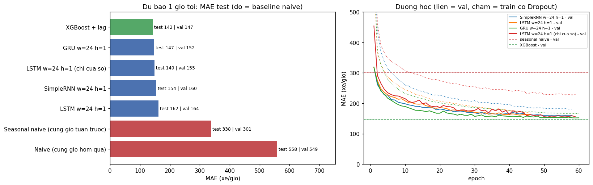
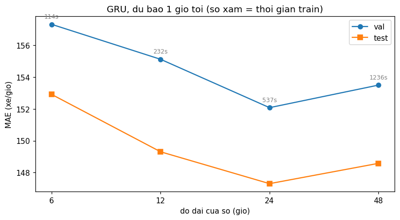
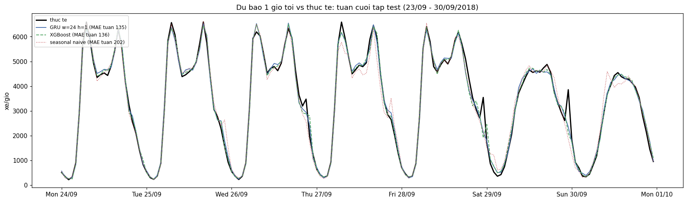
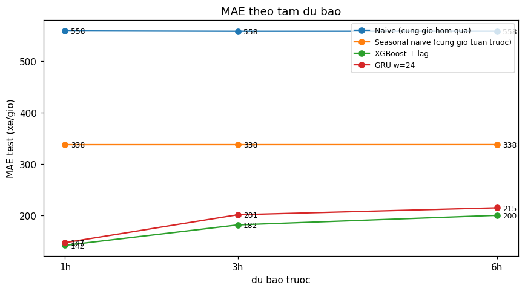
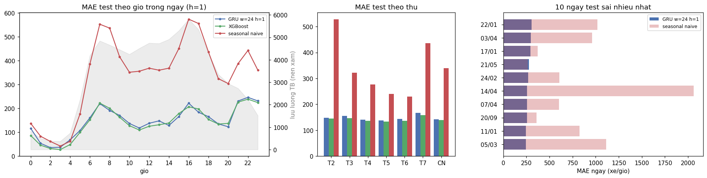

# TT-27 — RNN / LSTM
## Dự báo lưu lượng giao thông theo giờ để điều khiển đèn tín hiệu — kết quả thực nghiệm

| | |
|---|---|
| 🎓 **Khoá** | HỌC MÁY · [Buổi 14](https://github.com/TruongTanNghia/Training-Machine-learning/tree/main/Buoi-14-RNN-LSTM-Transformer) |
| 🧠 **Nhóm** | Deep Learning cho dữ liệu CHUỖI |
| 🔧 **Thuật toán** | SimpleRNN · LSTM · **GRU** · baseline naive / seasonal naive / XGBoost + lag |
| 🏭 **Lĩnh vực** | Giao thông đô thị |
| 📊 **Dữ liệu** | [Metro Interstate Traffic Volume (UCI)](https://archive.ics.uci.edu/dataset/492/metro+interstate+traffic+volume): 48.204 dòng theo giờ, cao tốc I-94 (Minnesota), 2012–2018 |

> **Kết quả chính:**
> * ✅ **Mạng hồi quy thắng seasonal naive rất rõ:** GRU (cửa sổ 24h) MAE test **147** xe/giờ (3 seed: 149,5 ± 3,1),
>   so với **338** của "giờ này = giờ này tuần trước". Giảm 56%.
> * ❌ **Nhưng không thắng XGBoost + lag:** **142** ở 1h, 182 ở 3h, 200 ở 6h, tốt hơn GRU ở **mọi** tầm dự báo, và
>   train trong **16 giây** so với **9 phút** của GRU (**nhanh hơn ~34 lần**).
> * **Kết luận trung thực: bài này không cần deep learning.** Khuyến nghị triển khai XGBoost + lag features.
> * GRU ≥ SimpleRNN ≈ LSTM với cửa sổ ngắn. Cửa sổ 6–48h cho MAE gần như nhau (chênh ≤ 5, cùng cỡ dao động seed), chỉ khác
>   thời gian train (48h chậm gấp 11 lần 6h).
> * Sai số lớn nhất đến từ **ngày tuyết** (7/10 ngày tệ nhất) và **đột biến 21–23h / sự cố giữa ngày**, những thứ không
>   có trong lịch sử lưu lượng.

---

## 1. Dữ liệu: 4 vấn đề và cách xử lý

| Vấn đề | Số liệu | Xử lý (`src/data.py`) |
|---|---|---|
| 1. **Lỗ hổng thời gian** | 52.551 giờ trong khoảng, chỉ 40.575 có dữ liệu → **thiếu 23%**. Lỗ dài nhất **308 ngày** (08/2014 → 06/2015) | Reindex theo giờ. Lỗ ≤ 3 giờ (2.771 giờ): nội suy + cột cờ `noi_suy`. 136 lỗ dài (9.205 giờ): giữ NaN, **không cửa sổ nào được bắc qua** |
| 2. **Ngoại lai phi lý** | `temp = 0 K` (10 dòng), `rain_1h = 9.831 mm` (1 dòng) | NaN rồi nội suy |
| 3. **Trùng `date_time`** | 7.629 dòng, cùng lưu lượng, chỉ khác mô tả thời tiết | Gộp 1 dòng/giờ, one-hot thời tiết lấy max |
| 4. **`holiday` chỉ ở dòng 0h** | 53 dòng | Lan ra cả ngày → 1.272 giờ |

Nhãn train/đánh giá **chỉ lấy giờ có dữ liệu thật**. Chi tiết: [data/DATA_SOURCE.md](data/DATA_SOURCE.md).


* Ngày thường có **2 đỉnh** (7h ≈ 6.100, 16h ≈ 6.300 xe/giờ). Cuối tuần và **ngày lễ** có 1 bình nguyên 12–16h ≈ 4.400.
* Theo thứ: T2–T6 ≈ 3.300–3.700, T7 ≈ 2.800, CN ≈ 2.400. Theo tháng chênh ít, thấp nhất tháng 12–1.

## 2. Thiết lập chống rò rỉ

| Nguyên tắc | Cách làm |
|---|---|
| ① Chia theo thời gian | 70/15/15 không xáo trộn: train 2012-10 → 2017-04 · val 2017-04 → 2018-01 · test 2018-01 → 2018-09. Chỉ xáo trộn các **cửa sổ** khi train |
| ② Scaler fit chỉ trên train | `sequences.Scaler.fit(feat, train_range)` |
| ③ Cửa sổ chỉ chứa quá khứ | `make_windows`: `assert idx.max(axis=1) < target` và `assert` không có NaN (không bắc qua lỗ) |
| Đánh giá công bằng | Mọi mô hình, mọi độ dài cửa sổ, đánh giá trên **cùng một tập giờ**: 24.534 / 6.378 / 6.435 mẫu (h = 1) |

**Đầu vào mạng nơ-ron:** cửa sổ `(w giờ, 22 đặc trưng)`: lưu lượng, nhiệt độ, mưa, tuyết, mây, one-hot thời tiết, cờ nội
suy, sin/cos giờ, sin/cos thứ, cuối tuần, ngày lễ. Thêm nhánh **thông tin biết trước** về giờ cần dự báo: lịch của giờ
đó + lưu lượng cùng giờ hôm qua / tuần trước. XGBoost nhận đúng các thông tin này dưới dạng lag features.

## 3. ⭐ So sánh với baseline (dự báo 1 giờ tới)



| Mô hình | Tham số | Epoch | Thời gian train | MAE val | **MAE test** | RMSE test |
|---|---:|---:|---:|---:|---:|---:|
| Naive (cùng giờ hôm qua) | — | — | — | 549 | 558 | 1.020 |
| **Seasonal naive (cùng giờ tuần trước)** | — | — | — | 301 | **338** | 647 |
| SimpleRNN (64 → 32) | 10.017 | 58 | 4 ph | 160 | 154 | 232 |
| LSTM (64 → 32) | 36.033 | 46 | 8 ph | 164 | 162 | 244 |
| LSTM chỉ cửa sổ (đúng mô hình của đề) | 34.721 | 59 | 7 ph | 155 | 149 | 226 |
| **GRU (64 → 32)** ← chọn theo val | 27.649 | 60 | 9 ph | **152** | **147** | 221 |
| **XGBoost + lag** | 892 cây | — | **16 s** | **147** | **142** | 222 |

* ✅ Mọi mạng hồi quy đều **thắng seasonal naive** (giảm ~55% MAE).
* **GRU tốt nhất** trong các mạng. LSTM không hơn SimpleRNN: cửa sổ 24 bước ngắn, thông tin quan trọng nhất là vài giờ
  vừa qua, nên "ký ức dài" của LSTM chưa có đất dùng.
* Nhánh thông tin biết trước **không giúp** LSTM (164 có so với 155 không có). Với cửa sổ 24h, giá trị "hôm qua" đã có sẵn
  trong cửa sổ.
* **Dao động theo seed** (GRU 24h, seed 42 / 1 / 2): test 147,3 / 148,1 / 153,0 → **149,5 ± 3,1**. Chênh lệch giữa GRU,
  SimpleRNN và LSTM-chỉ-cửa-sổ nằm trong cỡ nhiễu này. **XGBoost (142,1) thấp hơn cả seed tốt nhất của GRU**, nên lợi
  thế của nó là thật.

## 4. Độ dài cửa sổ



| GRU, 1 giờ tới | 6h | 12h | **24h** | 48h |
|---|---:|---:|---:|---:|
| MAE val | 157 | 155 | **152** | 153 |
| MAE test | 153 | 149 | **147** | 149 |
| Thời gian train | 2 ph | 4 ph | 9 ph | 21 ph |

MAE gần như **phẳng**, còn thời gian train tăng gần tuyến tính. Mẫu hình ngày/tuần đã nằm ở nhánh thông tin biết trước,
cửa sổ chỉ cần cho biết **mức hiện tại**. Cửa sổ dài (48h, hay 168h) không đáng chi phí.

## 5. Dự báo vs thực tế: 1 tuần cuối



Tuần 23–30/09/2018: GRU và XGBoost gần như trùng nhau (MAE tuần 135 / 136), bám sát cả hai đỉnh ngày thường lẫn bình nguyên
cuối tuần. Seasonal naive MAE 202. Không mô hình nào bắt được đột biến như đỉnh 22–23h tối thứ 7: dự báo 1 giờ tới chỉ
phản ứng **sau khi** đột biến đã xảy ra.

## 6. Dự báo nhiều bước



| MAE test (xe/giờ) | 1h | 3h | 6h | 1h → 6h |
|---|---:|---:|---:|---:|
| Naive (hôm qua) | 558 | 558 | 558 | 0 |
| Seasonal naive | 338 | 338 | 338 | 0 |
| **XGBoost + lag** | **142** | **182** | **200** | +41% |
| GRU 24h | 147 | 201 | 215 | +46% |

Mỗi tầm dự báo train một model riêng. Baseline naive không phụ thuộc h. Mô hình học máy xấu đi nhanh nhất từ 1h → 3h
(XGBoost +28%, GRU +37%), vì thông tin "lưu lượng hiện tại" cũ dần. Ở 6h tới, cả hai vẫn chỉ bằng ~60% sai số của
seasonal naive. Khoảng cách XGBoost – GRU **rộng ra** khi h tăng (5 → 20 → 15).

## 7. Phân tích lỗi



* **Theo giờ:** sai nhiều ở **hai đỉnh** (7h ≈ 220, 16h ≈ 222) và **21–23h (≈ 230–246)** dù lưu lượng buổi tối chỉ bằng
  1/2 đến 1/4 giờ cao điểm. **10/15 giờ sai nặng nhất là tăng đột biến lúc 21–23h** (vd 29/09 23h: thực tế 3.856, dự báo
  2.353). Đây có thể là sự kiện, phân luồng hoặc đóng đường ban đêm, những thông tin không có trong dữ liệu.
* **Theo thứ:** GRU/XGBoost đều 134–166 mọi ngày. Seasonal naive tệ nhất **thứ 2 (527)** vì **4/6 ngày lễ trong test rơi
  vào thứ 2** (MLK Day, Washington's Birthday, Memorial Day, Labor Day): sai cả chính ngày lễ lẫn thứ 2 tuần sau.
* **10 ngày sai nhiều nhất: 7/10 có tuyết 13–23 giờ trong ngày.** Ngày 14/04/2018 (tuyết 23 giờ): lưu lượng TB 1.144
  so với 3.204 tuần trước. Seasonal naive sai 2.061/giờ, GRU chỉ sai 258, vì GRU thấy lưu lượng mấy giờ vừa qua đã giảm.
* Hai giờ sai nặng nhất là **sụt giảm giữa ngày** (21/05 13h: 2.040 so với dự báo 4.848; 17/01 15h), kiểu sự cố không
  đoán trước được từ lịch sử.

→ Muốn giảm sai số, cần **dữ liệu mới** (dự báo thời tiết giờ tới, lịch sự kiện, sự cố), không phải mạng phức tạp hơn.

## 8. Kết luận

| | XGBoost + lag | GRU 24h |
|---|---|---|
| MAE test 1h / 3h / 6h | **142 / 182 / 200** | 147 / 201 / 215 |
| Thời gian train (1h) | **16 s** | 9 ph |
| Tiền xử lý | lag features, không chuẩn hoá | chuẩn hoá, cắt cửa sổ có kiểm tra lỗ hổng |
| Độ ổn định | tất định | ± 3,1 theo seed |

1. Tiêu chí "LSTM phải thắng seasonal naive": **đạt** (GRU 147, LSTM 149–162 so với 338).
2. Nhưng **XGBoost + lag cho kết quả tốt hơn, nhanh hơn ~34 lần**. Đúng tình huống đề nêu: với bài này, **không cần deep
   learning**.
3. GRU đáng thử khi có nhiều chuỗi liên quan (nhiều nút giao cùng lúc), khi cần dự báo cả chuỗi 24 giờ một lần (Seq2Seq),
   hoặc làm thành phần trong ensemble.

## 9. Cạm bẫy: thực tế trong bài

| Cạm bẫy | Thực tế |
|---|---|
| Coi dữ liệu liên tục dù có lỗ hổng | `tao_chuoi` của đề sẽ ghép 06/08/2014 với 11/06/2015 trong một cửa sổ. `make_windows` có `assert` chặn |
| Shuffle khi chia | Chia theo mốc thời gian. Chỉ shuffle cửa sổ khi `fit` |
| Scaler fit trên toàn bộ | Fit trên train (TB 3.282, độ lệch chuẩn 1.976) |
| Không có baseline naive | Có cả 2. "Hôm qua" (558) tệ hơn hẳn "tuần trước" (338) vì thứ 2 / thứ 7 |
| Activation ở Dense cuối | `Dense(1)` không activation |
| Cửa sổ quá dài | 48h chậm gấp 11 lần 6h, MAE như nhau |
| *(thêm)* So sánh trên tập mẫu khác nhau | Cửa sổ 48h loại nhiều mẫu hơn 6h → dùng **cùng** tập mốc cho mọi mô hình |
| *(thêm)* Đọc `holiday` bằng `pd.read_csv` mặc định | Chuỗi `"None"` bị biến thành NaN → phải `keep_default_na=False` |

---

## Cấu trúc & cách chạy

```
TT-27-RNN-LSTM/
├── README.md                          ← báo cáo này
├── requirements.txt
├── data/DATA_SOURCE.md                ← CSV tự tải từ UCI (không commit)
├── notebooks/lstm_traffic.ipynb       ← giải thích logic code từng bước + đọc kết quả
├── src/
│   ├── data.py        ← tải, làm sạch 4 vấn đề, reindex, đặc trưng, chia theo thời gian
│   ├── sequences.py   ← Scaler (fit train), valid_anchors, make_windows (cửa sổ + thông tin biết trước), tree_matrix
│   └── train.py       ← baseline, XGBoost, build_rnn, mỗi bước của đề là một hàm; main() chạy toàn bộ
├── models/lstm_traffic.keras          ← GRU 24h, h=1 (+ models/scaler.json); models/runs/ không commit
└── reports/   eda_theo_gio.png · rnn_lstm_gru.png · do_dai_cua_so.png · du_bao_vs_thuc_te.png
               du_bao_nhieu_buoc.png · phan_tich_loi.png · *.csv · tom_tat.json
```

```bash
pip install -r requirements.txt
python src/train.py                  # lần đầu ~1,5 giờ trên CPU; lần sau đọc lại models/runs/ (~2 phút)
TT27_RETRAIN=1 python src/train.py   # bắt buộc train lại
```

Môi trường: Python 3.13, TensorFlow 2.21 (CPU), XGBoost 3.4. Seed 42, `enable_op_determinism()`.
File model tên `lstm_traffic.keras` theo đề, nhưng chứa **GRU** (kiểu tốt nhất theo val).

**Mở rộng chưa làm:** Bidirectional LSTM (không hợp lệ cho dự báo, vì nhánh ngược sẽ nhìn dữ liệu sau thời điểm dự báo);
Seq2Seq dự báo 24 giờ cùng lúc; so sánh với Transformer (TT-28).

**Tham khảo:** [Buổi 14 — RNN, LSTM, Transformer](https://github.com/TruongTanNghia/Training-Machine-learning/tree/main/Buoi-14-RNN-LSTM-Transformer/Tai-Lieu) · [Buổi 9 — Time Series](https://github.com/TruongTanNghia/Training-Machine-learning/tree/main/Buoi-09-TimeSeries/Tai-Lieu/ly_thuyet_chi_tiet_buoi_09.md)
