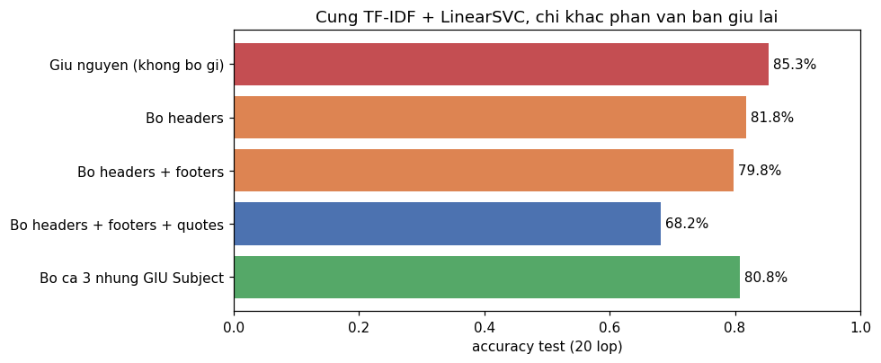
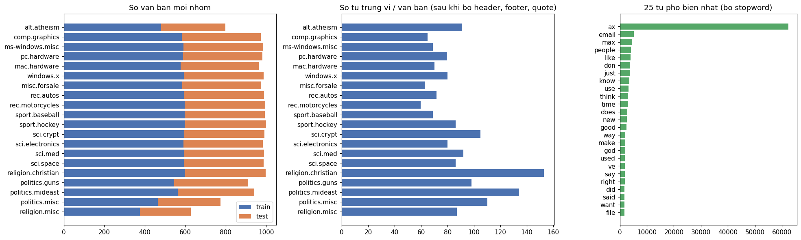
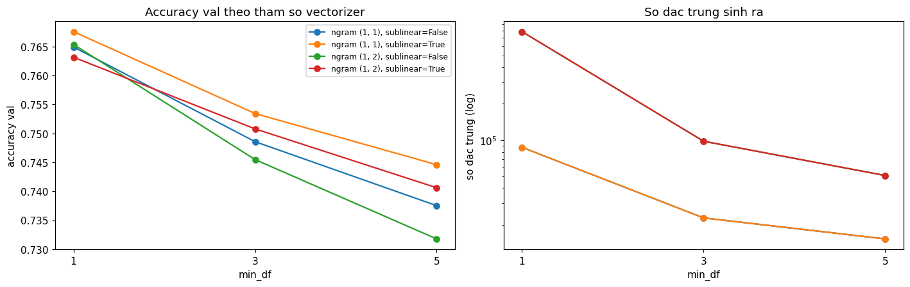
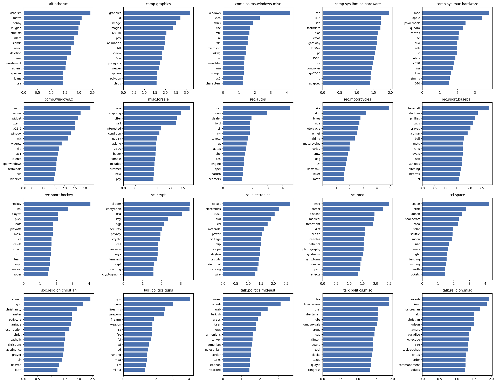
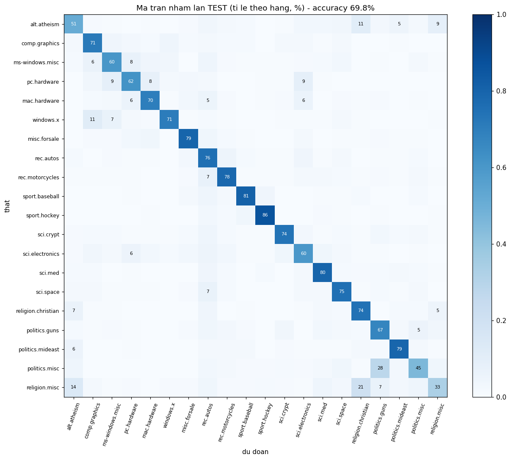
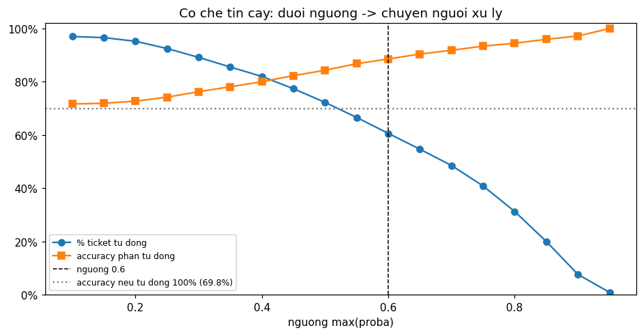

# TT-29 — TF-IDF
## Tự động phân loại ticket hỗ trợ khách hàng về đúng bộ phận — kết quả thực nghiệm

| | |
|---|---|
| 🎓 **Khoá** | HỌC MÁY · [Buổi 8](https://github.com/TruongTanNghia/Training-Machine-learning/tree/main/Buoi-08-NLP) |
| 🧠 **Nhóm** | NLP · Biểu diễn văn bản |
| 🔧 **Thuật toán** | TF-IDF + LinearSVC / Logistic Regression / Naive Bayes · CalibratedClassifierCV |
| 🏭 **Lĩnh vực** | CSKH · Vận hành dịch vụ |
| 📊 **Dữ liệu** | 20 Newsgroups (`sklearn.datasets.fetch_20newsgroups`): 11.314 train + 7.532 test, 20 nhóm |

> **Kết quả chính:**
> * ⭐ **Rò rỉ chiếm 17 điểm accuracy:** 85,3% khi giữ nguyên → **68,2%** khi bỏ headers + footers + quotes. Nguồn rò rỉ
>   là **danh tính người viết** (email, tên, máy chủ, chữ ký) và **trích dẫn**. Dòng `Newsgroups:` mà đề nhắc chỉ có
>   ở 45 / 11.314 bài.
> * Sau khi bỏ rò rỉ: ComplementNB **71,8%**, LinearSVC 69,7%, LogReg 69,1% (mức tham chiếu của đề: 69–73%).
> * **Bản triển khai:** TF-IDF + LinearSVC + `CalibratedClassifierCV(ensemble=False)`: **~3 ms / ticket**, train lại 12 s.
>   Code mẫu của đề (`cv=3`) mất ~7 ms, **không đạt** < 5 ms.
> * ⭐ **Ngưỡng tin cậy 0,6:** **60,6% ticket tự động với độ chính xác 88,6%**, 39,4% chuyển người.
> * Tiêu đề (Subject) là thông tin hợp lệ và mạnh: giữ riêng tiêu đề nâng 68,2% lên **80,8%**.

---

## 1. ⭐ Bảng chứng minh rò rỉ



Cùng pipeline `TF-IDF (1,2)-gram, min_df=3, max_df=0,8, sublinear + LinearSVC(C=1)`, train → test, chỉ khác văn bản giữ lại:

| Biến thể | Accuracy test | Mất so với bản gốc |
|---|---:|---:|
| Giữ nguyên (không bỏ gì) | **85,3%** | — |
| Bỏ headers | 81,8% | −3,6 |
| Bỏ headers + footers | 79,8% | −5,5 |
| **Bỏ headers + footers + quotes** | **68,2%** | **−17,2** |
| Bỏ cả 3 nhưng **giữ Subject** | 80,8% | −4,5 |

**Model học gì khi có rò rỉ?** Top từ của bản gốc toàn là **người và máy chủ**: `keith`, `mathew` (alt.atheism) ·
`clh`, `athos`, `rutgers edu` (địa chỉ người kiểm duyệt soc.religion.christian) · `serdar`, `argic` (một bot spam ở
talk.politics.mideast) · `kaldis`, `cramer`, `teel` (talk.politics.misc) · `cica` (máy chủ FTP của nhóm Windows).

* **Quotes đóng góp nhiều nhất (−11,6 điểm):** trích bài trước cùng chủ đề gần như cho không đáp án.
* Mức chênh 85% → 68% nhỏ hơn mức "~95% → ~70%" đề nêu. Có thể vì test của sklearn là các bài đăng **sau** train:
  một phần tác giả cũ không xuất hiện lại, nên rò rỉ "nhận ra người viết" yếu bớt.
* **Bài học cho ticket thật:** bỏ tên/email khách, chữ ký nhân viên, email trích dẫn, mã hàng đợi. **Giữ** tiêu đề ticket.

## 2. Dữ liệu (bản đã bỏ rò rỉ)



* 377–600 bài train / nhóm (gần cân bằng, Dummy = 5,3%). Độ dài lệch mạnh: trung vị 59–153 từ.
* **300 bài train (2,7%) và 215 bài test rỗng** sau khi bỏ: những bài chỉ có trích dẫn hoặc chữ ký.
* Từ phổ biến nhất là `ax` (62.387 lần) nhưng chỉ đến từ **20 bài** chứa file nhị phân uuencode (`MAX>'AX>'AX>...`).
  Đây là rác. `sublinear_tf` giảm ảnh hưởng của nó.
* Ẩn danh (`preprocess.an_danh`): email → `EMAIL` (1.735 bài train), URL → `URL`, số điện thoại → `PHONE`.
* Chia: test của sklearn giữ nguyên (chia sẵn theo thời gian). Tách 20% train làm **val** (stratify) để chọn tham số.
  Vectorizer luôn nằm **trong pipeline**, nên chỉ fit trên phần train của mỗi lần fit.

## 3. Khảo sát tham số vectorizer (LinearSVC, accuracy val)



| ngram | min_df | sublinear_tf | Số đặc trưng | Accuracy val | Fit |
|---|---:|:---:|---:|---:|---:|
| **(1,1)** | **1** | **True** | 87.126 | **0,768** | 5 s |
| (1,1) | 1 | False | 87.126 | 0,765 | 5 s |
| (1,1) | 3 | True | 22.773 | 0,753 | 4 s |
| (1,1) | 5 | True | 15.275 | 0,745 | 4 s |
| (1,2) | 1 | True | 785.901 | 0,763 | 21 s |
| (1,2) | 3 | True | 97.834 | 0,751 | 12 s |
| (1,2) | 5 | True | 51.015 | 0,741 | 10 s |

* **`min_df=1` tốt nhất**, ngược với cảnh báo của đề, nhưng chỉ hơn `min_df=3` **1,4 điểm** với số đặc trưng gấp 3,8 lần.
* **Bigram không giúp**, mà tăng số đặc trưng 9 lần và thời gian fit gần 5 lần.
* **`sublinear_tf=True` tốt hơn ở 5/6 cấu hình** (+0,3 đến +0,9 điểm).
* `max_features` 20k / 50k / không giới hạn → 0,749 / 0,764 / 0,768. Chọn: unigram, min_df=1, sublinear, không giới hạn
  (98.117 đặc trưng trên toàn bộ train).

## 4. So sánh bộ phân loại (cùng TF-IDF)

| | Tham số (chọn trên val) | Accuracy val | **Accuracy test** | Macro-F1 test | Fit |
|---|---|---:|---:|---:|---:|
| Dummy | — | 0,053 | 0,053 | 0,005 | — |
| MultinomialNB | alpha 0,01 | 0,722 | 0,659 | 0,643 | — |
| **ComplementNB** | alpha 0,3 | **0,788** | **0,718** | 0,698 | **3,7 s** |
| LogisticRegression | C 3 | 0,750 | 0,691 | 0,678 | 62 s |
| LinearSVC | C 1 | 0,768 | 0,697 | 0,685 | 7 s |

**ComplementNB thắng** (+2 điểm so với LinearSVC). Val cao hơn test ~7 điểm ở mọi mô hình vì test là bài đăng **sau**:
đây là lệch phân phối theo thời gian, đúng như khi có ticket về sản phẩm mới.

## 5. Chọn bản triển khai: cần xác suất + < 5 ms / ticket

| Cách lấy xác suất | Accuracy test | Tự động ở ngưỡng 0,6 (accuracy) | 1 ticket |
|---|---:|---:|---:|
| ComplementNB, xác suất gốc | 71,8% | **3,0%** (98,7%) | 12 ms ❌ |
| ComplementNB + Calibrated cv=3 | **71,9%** | 52,1% (**93,3%**) | 41 ms ❌ |
| ComplementNB + Calibrated ensemble=False | 71,7% | 57,5% (91,4%) | 14 ms ❌ |
| LinearSVC + Calibrated cv=3 (code mẫu của đề) | 70,0% | 53,3% (91,1%) | 6,7–7,3 ms ❌ |
| **LinearSVC + Calibrated ensemble=False** ← triển khai | 69,8% | **60,6%** (88,6%) | **2,8–3,2 ms ✅** |

* Xác suất gốc của Naive Bayes **vô dụng cho cơ chế ngưỡng** (độ tin cậy TB 0,17). Bắt buộc phải hiệu chỉnh.
* `cv=3` chạy 3 mô hình mỗi lần dự đoán. `ensemble=False` chỉ chạy 1 mô hình (fit trên toàn bộ train) + bộ hiệu chỉnh
  học từ dự đoán cross-validation, nên nhanh gấp ~3 lần.
* **Đánh đổi:** NB đã hiệu chỉnh chính xác hơn ~2 điểm nhưng chậm 5–15 lần. Yêu cầu < 5 ms là ràng buộc cứng, nên chọn
  LinearSVC. Lưu ở `models/tfidf_pipeline.joblib` (17,8 MB).

## 6. ⭐ Top 15 từ đặc trưng mỗi lớp



| Nhóm | Top từ (trích) |
|---|---|
| comp.graphics | graphics, 3d, image, images, pov, animation, tiff, polygons, viewer |
| comp.sys.mac.hardware | mac, apple, powerbook, quadra, centris, duo, nubus, simms |
| rec.sport.hockey | hockey, nhl, playoff, puck, leafs, playoffs, ice, devils, coach |
| sci.crypt | clipper, encryption, nsa, key, pgp, security, privacy, crypto, des |
| sci.space | space, orbit, launch, spacecraft, nasa, solar, shuttle, moon, lunar |
| talk.politics.guns | gun, guns, firearms, weapons, nra, fbi, atf, hunting, militia |

Đầy đủ 20 nhóm: `reports/top_tu_moi_lop.csv`. Kiểm tra bằng mắt:

* **Phần lớn hợp lý**, nên dùng được để **giải thích** cho nhân viên vì sao ticket vào bộ phận đó.
* ⚠️ **Rò rỉ còn sót qua tên người trong thân bài:** `bobby`, `nanci` (atheism), `vesselin` (crypt), `serdar` (mideast),
  `kent`, `ekr`, `critus` (religion.misc), `deane`, `teel` (politics.misc), `roger` (hockey). Bỏ header không xoá được
  tên khi người viết tự ký hoặc được gọi tên. Với ticket: **ẩn danh cả tên khách và tên nhân viên trong thân ticket**.
* Mã sản phẩm (`f550iw`, `gw2000`, `c650`) rất đặc hiệu nhưng sẽ lỗi thời, nên cần **train lại định kỳ** (12 giây).

## 7. Ma trận nhầm lẫn



| Thật → dự đoán | Số bài | % lớp thật |
|---|---:|---:|
| talk.politics.misc → talk.politics.guns | 87 | **28%** |
| talk.religion.misc → soc.religion.christian | 52 | 21% |
| comp.windows.x → comp.graphics | 45 | 11% |
| talk.religion.misc → alt.atheism | 35 | 14% |
| comp.sys.ibm.pc.hardware → electronics / ms-windows / mac | 34 / 34 / 32 | 8–9% |

Nhầm theo **cụm chủ đề** (tôn giáo · chính trị · phần cứng máy tính). Recall thấp nhất ở các nhóm "misc": religion.misc
**33%**, politics.misc 45%, atheism 51%. Cao nhất: hockey 86%. Với ticket: bộ phận có phạm vi chồng lấn nên được
**định nghĩa lại hoặc gộp**, việc này hiệu quả hơn cố tăng accuracy.

## 8. ⭐ Cơ chế tin cậy



| Ngưỡng max(proba) | % tự động | Accuracy phần tự động | % cần người |
|---:|---:|---:|---:|
| 0,5 | 72,3% | 84,3% | 27,7% |
| **0,6** | **60,6%** | **88,6%** | **39,4%** |
| 0,7 | 48,6% | 91,9% | 51,4% |
| 0,8 | 31,3% | 94,5% | 68,7% |

Ở 0,6, với 2.000 ticket/ngày: ~1.210 ticket tự động (sai ~11%, thấp hơn mức 18% bị chuyển sai hiện nay), ~790 ticket
do người xử lý. Trên phần chuyển người, model chỉ đúng 41%: ngưỡng đã lọc đúng những ca khó.

## 9. Thời gian

| | |
|---|---|
| Dự đoán 1 ticket (TF-IDF + LinearSVC + hiệu chỉnh) | **trung vị 2,9–3,3 ms**, p95 5,1–5,6 ms (2 lần đo; đỉnh 14–39 ms khi máy bận) |
| Dự đoán theo lô | ~4.000–4.700 ticket / giây |
| Train lại toàn bộ (11.314 văn bản) | ~12 s |
| Nạp model | 0,3 s (17,8 MB) |

✅ Đạt yêu cầu < 5 ms (trung vị). p95 nhích quá ngưỡng một chút: nếu SLA tính theo p95/p99, cân nhắc `min_df=3` (ít đặc trưng hơn
3,8 lần, accuracy val kém ~1,4 điểm).

## 10. Phân tích 10 ca sai

| Thật → dự đoán | Tin cậy | Nguyên nhân |
|---|---:|---|
| atheism → sci.crypt | 0,94 | Bài về **Clipper chip** đăng nhầm nhóm. **Nhãn sai, model đúng** |
| graphics → ms-windows | 0,94 | Cài font ATM **trong Windows**: chồng lấn thật |
| religion.misc → sci.space | 0,93 | Bài 3.515 từ về "thuyết vũ trụ Larsonian": nội dung là thiên văn |
| windows.x → ms-windows | 0,93 | Nói về mạng TCP/IP, không có từ đặc trưng của X Window |
| atheism → christian | 0,92 | Chuyển tiếp thư của một người Kitô giáo |
| forsale → mac.hardware | 0,59 | "Bán 4 SIMM cho Mac": **thuộc cả 2 nhóm** (đa nhãn) |
| religion.misc → christian | 0,59 | Tranh luận thần học, 2 nhóm chồng lấn |
| sci.med → mideast | 0,31 | Chuyện lạc đề, tin cậy thấp → **đã chuyển người** |
| guns → sci.med | 0,22 | Thảo luận lạc đề → **đã chuyển người** |
| windows.x → sci.space | 0,69 | "dvi viewer for **X**": `token_pattern` mặc định bỏ từ 1 ký tự, nên mất từ khoá "X" |

* 5 ca sai **tự tin** nhất đều là bài có nội dung thật sự thuộc nhóm được dự đoán (đăng nhầm, cross-post, lạc đề).
* **Độ dài quyết định:** bài rỗng đúng 9,8%, 1–10 từ 35%, 11–50 từ 60%, 51–200 từ 76%, > 200 từ 82%. Ticket quá ngắn nên
  luôn chuyển người hoặc hỏi thêm khách.

## 11. Hạn chế của TF-IDF

* **Không hiểu nghĩa:** "tuyệt vời" và "hay", "car" và "automobile" là các chiều khác nhau hoàn toàn.
* **Mất thứ tự từ:** "không lỗi thanh toán" và "lỗi không thanh toán" giống hệt nhau với unigram.
* **Bỏ từ 1 ký tự** theo mặc định (X, C, R): ca sai cuối ở trên.
* **Từ vựng cố định lúc fit:** sản phẩm / từ lóng mới là từ ngoài từ điển cho tới lần train sau.
* **Thử nghiệm LSA (mở rộng 1):** TruncatedSVD 100 / 300 / 1.000 chiều cho 58,5% / 64,9% / 67,4%, đều **thấp hơn**
  TF-IDF đầy đủ (69,7%) và chậm hơn nhiều (1.000 chiều mất 7 phút). Gộp từ thành "chủ đề ẩn" làm mất các từ hiếm
  nhưng đặc hiệu.

## 12. Cạm bẫy: thực tế trong bài

| Cạm bẫy | Thực tế |
|---|---|
| Quên `remove=(...)` | +17 điểm ảo (85,3% so với 68,2%) |
| `fit` vectorizer trên toàn bộ dữ liệu | Vectorizer nằm trong pipeline, fit lại ở mỗi lần fit |
| LinearSVC cần xác suất | `CalibratedClassifierCV`. Dùng `ensemble=False` để đạt < 5 ms |
| `min_df=1` → overfit | Không xảy ra với LinearSVC (tốt nhất 0,768), nhưng tốn bộ nhớ gấp 3,8 lần |
| *(thêm)* Bỏ header là đủ | Tên người trong thân bài vẫn lọt vào top từ → phải ẩn danh thân bài |
| *(thêm)* Xác suất Naive Bayes dùng thẳng cho ngưỡng | Chỉ 3% vượt 0,6 → phải hiệu chỉnh |

---

## Cấu trúc & cách chạy

```
TT-29-TF-IDF/
├── README.md                                    ← báo cáo này
├── requirements.txt
├── notebooks/tfidf_ticket_classification.ipynb  ← giải thích logic code từng bước + đọc kết quả
├── src/
│   ├── preprocess.py   ← load (remove / giữ Subject), an_danh (email, URL, số điện thoại), tách val
│   └── train.py        ← mỗi bước của đề là một hàm run_*(); main() chạy toàn bộ
├── models/tfidf_pipeline.joblib                 ← TF-IDF + LinearSVC + CalibratedClassifierCV(ensemble=False)
└── reports/  leakage_comparison.png · top_tu_moi_lop.png · confusion_matrix.png · nguong_tin_cay.png
              eda.png · khao_sat_vectorizer.png · *.csv · tom_tat.json
```

```bash
pip install -r requirements.txt
python src/train.py      # ~15 phút trên CPU (riêng LSA 1.000 chiều ~7 phút); dữ liệu tự tải lần đầu (~14 MB)
```

```python
import joblib
pipe = joblib.load("models/tfidf_pipeline.joblib")
from sklearn.datasets import fetch_20newsgroups
ten_nhom = fetch_20newsgroups(subset="test").target_names
p = pipe.predict_proba(["My monitor flickers after installing the new video driver"])[0]
bo_phan = ten_nhom[p.argmax()] if p.max() >= 0.6 else "chuyen nguoi xu ly"
# -> du doan comp.sys.mac.hardware voi tin cay 0,54 < 0,6, nen ticket nay duoc chuyen nguoi
```

Môi trường: Python 3.13, scikit-learn 1.8.

**Mở rộng chưa làm:** so sánh PhoBERT / DistilBERT (xem TT-28); học trực tuyến `SGDClassifier.partial_fit()`; phân loại
đa nhãn (ca "bán SIMM cho Mac"); thử `token_pattern=r"(?u)\b\w+\b"` để giữ từ 1 ký tự.

**Tham khảo:** [Buổi 8 — TF-IDF & NLP](https://github.com/TruongTanNghia/Training-Machine-learning/tree/main/Buoi-08-NLP/Tai-Lieu/ly_thuyet_chi_tiet_buoi_08.md)
