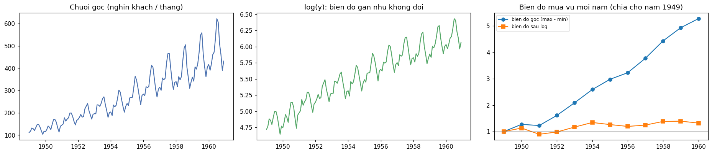
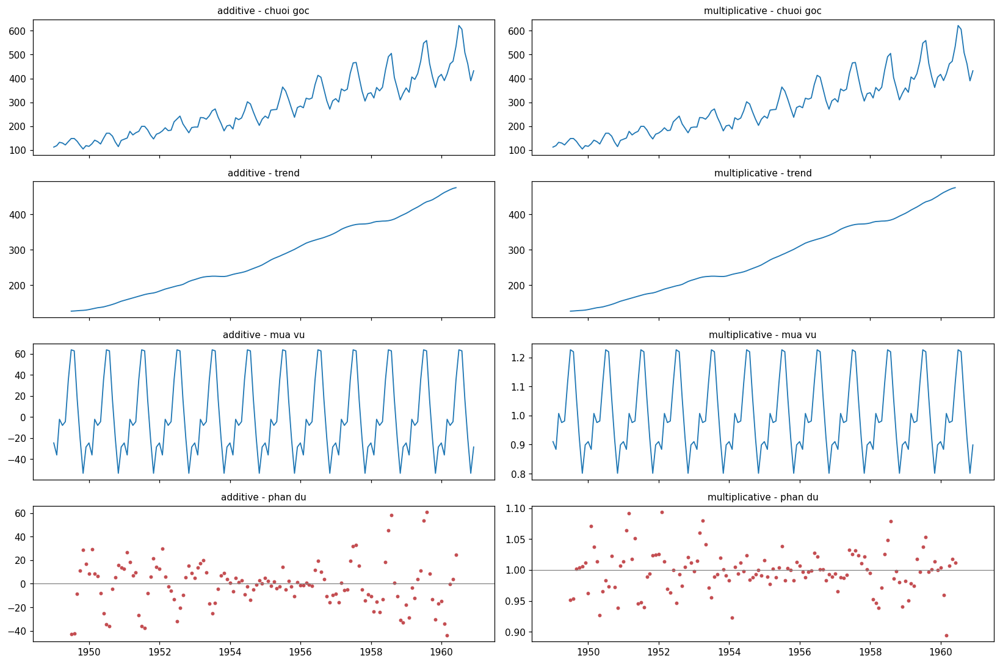
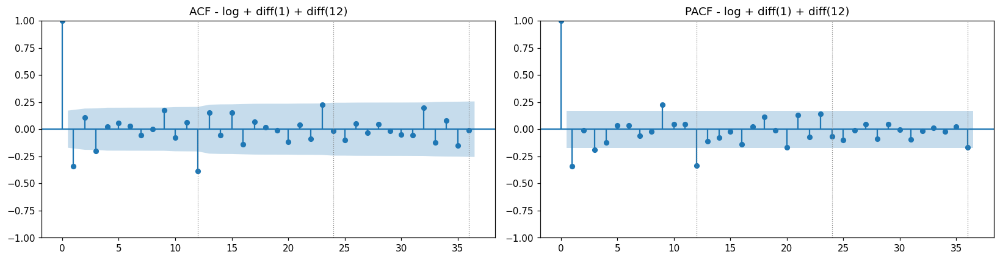
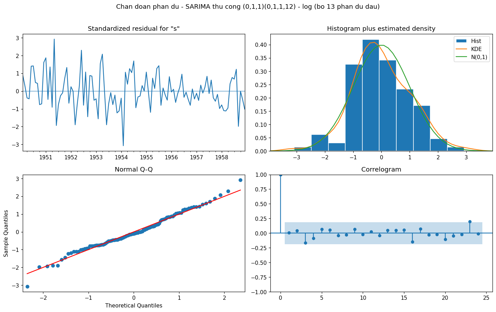
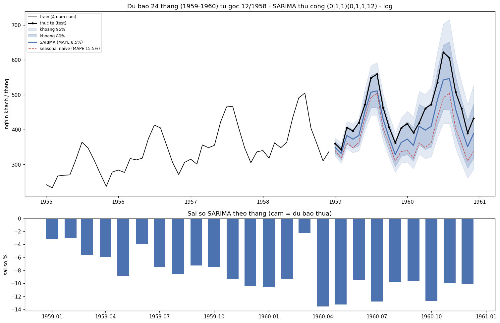

# TT-30 — ARIMA / SARIMA
## Dự báo lượng khách hàng tháng để lập kế hoạch nhân sự — kết quả thực nghiệm

| | |
|---|---|
| 🎓 **Khoá** | HỌC MÁY · [Buổi 9](https://github.com/TruongTanNghia/Training-Machine-learning/tree/main/Buoi-09-TimeSeries) |
| 🧠 **Nhóm** | Chuỗi thời gian · Mô hình thống kê |
| 🔧 **Thuật toán** | **SARIMA(0,1,1)(0,1,1,12)** trên log · quy trình Box-Jenkins |
| 🏭 **Lĩnh vực** | Dịch vụ · Hàng không · Bán lẻ |
| 📊 **Dữ liệu** | AirPassengers: 144 tháng (1949–1960), nghìn khách quốc tế / tháng |

> **Kết quả chính:**
> * Chuỗi **nhân tính** (biên độ mùa vụ tăng 5,3 lần theo trend) → lấy log. **d = D = 1** (ADF p = 0,0002 sau
>   log + diff(1) + diff(12)). ACF tắt sau lag 1 và 12 → **SARIMA(0,1,1)(0,1,1,12)** ("airline model"). Lưới AIC
>   81 mô hình chọn **đúng mô hình này**.
> * ⭐ Phần dư là **nhiễu trắng**: Ljung-Box p = 0,91 (lag 12), 0,80 (lag 24). Jarque-Bera p = 0,58.
> * ⭐ **Dự báo 24 tháng (1959–1960): MAPE 8,5%**, so với seasonal naive 15,5% và naive 23,6%. **Dự báo 1 tháng tới:
>   MAPE 2,6%**. Backtest 4 gốc: 6,2% so với 13,6% của seasonal naive.
> * ⭐ **Tỉ lệ phủ:** khoảng 95% chứa **24/24** giá trị thật, khoảng 80% chứa 23/24. Gộp 4 gốc backtest: 99% / 92%.
>   Khoảng hơi rộng nhưng dùng được.
> * ⚠️ Code mẫu `enforce_stationarity=False, enforce_invertibility=False` làm **AIC so sánh sai** (tính trên 93–106
>   điểm tuỳ mô hình) và chọn nhầm một mô hình không có mùa vụ (MAPE 14,7%).

---

## 1. Nhìn chuỗi: mô hình nhân tính



| | 1949 | 1960 | Tăng |
|---|---:|---:|---:|
| Biên độ mùa vụ (max − min trong năm), thang gốc | 44 | 232 | **×5,3** |
| Biên độ trên thang log | 0,35 | 0,47 | ×1,3 |

Trend tăng 112 → 432 nghìn khách, mùa vụ 12 tháng (đỉnh tháng 7–8, đáy tháng 11). Biên độ tỉ lệ với mức chuỗi, nên đây
là mô hình **nhân tính** → **lấy log**. Log ổn định phần lớn nhưng chưa hoàn toàn (biên độ log vẫn tăng 1,3 lần).



Phần dư `additive` **xoè ra hai đầu** chuỗi (±40–60), phần dư `multiplicative` dao động đều quanh 1 (±5–10%).

## 2. ⭐ Bảng ADF: chọn d và D

| Phiên bản chuỗi | ADF p-value | Kết luận | KPSS p (đối chứng) |
|---|---:|---|---:|
| Gốc | 0,9919 | không dừng | 0,01 (không dừng) |
| log | 0,4224 | không dừng | 0,01 (không dừng) |
| log + diff(1) | 0,0711 | **sát ngưỡng, không dừng** | 0,10 (dừng) |
| log + diff(12) | 0,0724 | sát ngưỡng, không dừng | 0,10 (dừng) |
| **log + diff(1) + diff(12)** | **0,0002** | **dừng** ✅ | 0,10 (dừng) |

→ **d = 1, D = 1.** Một sai phân là chưa đủ: diff(1) còn mùa vụ, diff(12) còn trend dư.

## 3. ACF / PACF → chọn (p, q)(P, Q)



Trên log + diff(1) + diff(12) (131 điểm, ngưỡng ±0,171):

| Lag | ACF | PACF | |
|---:|---:|---:|---|
| **1** | **−0,34** | −0,34 | vượt ngưỡng |
| 3 | −0,20 | −0,19 | nhỉnh hơn ngưỡng một chút |
| 9 | +0,18 | +0,23 | nhỉnh hơn ngưỡng một chút |
| **12** | **−0,39** | −0,34 | vượt ngưỡng |

* ACF **tắt hẳn** sau lag 1 (tầng thường) và sau lag 12 (tầng mùa, lag 24 và 36 trong ngưỡng) → **MA(1)** và **SMA(1)**.
* PACF giảm dần thay vì tắt, nên đây là dấu hiệu MA, không phải AR.
* Lag 3 và 9 sát ngưỡng: với 36 lag × 5% thì kỳ vọng ~2 lag vượt ngưỡng do ngẫu nhiên, nên bỏ qua.

→ **SARIMA(0,1,1)(0,1,1,12)** trên log.

## 4. Mô hình: thủ công, lưới AIC, và bẫy `enforce_*=False`

Chia theo thời gian: **120 tháng train (1949–1958) · 24 tháng test (1959–1960)**. Chọn bậc chỉ dùng train.

| Mô hình (log) | AIC (train) | MAPE test | Phủ 95% | Ljung-Box p lag 12 / 24 |
|---|---:|---:|---:|---:|
| **(0,1,1)(0,1,1,12)** ← thủ công = AIC tốt nhất | **−389,0** | 8,5% | 100% | 0,91 / 0,80 |
| (1,1,1)(1,1,1,12) (gợi ý của đề) | −385,4 | 7,8% | 100% | 0,96 / 0,86 |
| (0,1,1)(0,1,1,12) **KHÔNG log** | — | **14,4%** | **50%** | 0,81 / 0,16 |

* **Lưới AIC:** p, q, P, Q ∈ {0,1,2}, d = D = 1 → 81 mô hình. AIC tốt nhất = (0,1,1)(0,1,1,12), **trùng bậc thủ công**.
  Top 10 đều có SMA(1) hoặc SMA(2), AIC chênh ≤ 2,4.
* **Đừng chọn theo test:** MAPE test của 81 mô hình dao động 6,4%–15,2%. Mô hình có MAPE test thấp nhất xếp hạng
  **75/81** theo AIC: chỉ là may mắn trên 24 điểm.
* **Không log:** sai gấp 1,7 lần, và khoảng 95% chỉ phủ 50% (khoảng 80% phủ 8%). Mô hình cộng tính giữ nguyên biên độ
  mùa vụ của train, không phình theo trend.

### ⚠️ Bẫy `enforce_stationarity=False, enforce_invertibility=False` (code mẫu của đề)

| Mô hình | `False`: số điểm tính likelihood | AIC | Hạng | `True`: số điểm | AIC | Hạng |
|---|---:|---:|---:|---:|---:|---:|
| (1,1,0)(0,1,0,12) | 106 | −360,0 | **1** | 107 | −363,6 | 4 |
| (2,1,2)(0,1,0,12) | 104 | −350,7 | 2 | 107 | −361,2 | 5 |
| (0,1,1)(0,1,1,12) | **93** | −340,7 | 3 | 107 | **−389,0** | **1** |
| (1,1,1)(1,1,1,12) | 93 | −332,6 | 5 | 107 | −385,4 | 3 |

Khi tắt ràng buộc, statsmodels khởi tạo "diffuse" và bỏ qua số quan sát đầu **bằng số trạng thái của mô hình** (14–27).
Mô hình có thành phần mùa bị tính trên ít điểm hơn 13 điểm, nên AIC "thua" giả tạo. Lưới AIC khi đó chọn
(1,1,0)(0,1,0,12): không có mùa vụ, phần dư còn tự tương quan ở lag 12 (Ljung-Box p = 0,001), MAPE 14,7%. **Dùng mặc định
`enforce=True` khi so AIC** (mọi mô hình đều bỏ đúng 13 điểm do sai phân 1 + 12).

## 5. ⭐ Kiểm tra phần dư



| Lag | Ljung-Box Q | p-value | Kết luận |
|---:|---:|---:|---|
| 6 | 4,9 | 0,56 | nhiễu trắng |
| 12 | 6,1 | **0,91** | nhiễu trắng |
| 18 | 10,5 | 0,91 | nhiễu trắng |
| 24 | 18,0 | **0,80** | nhiễu trắng |

(bỏ 13 phần dư đầu, là giai đoạn khởi tạo của sai phân)

* Correlogram không lag nào vượt dải. Jarque-Bera p = 0,58, độ lệch 0,17, độ nhọn 3,36: gần chuẩn, nên khoảng tin cậy
  (vốn giả định chuẩn) đáng tin. Q-Q chỉ lệch nhẹ ở 2 đuôi.
* Tham số: θ₁ = −0,34 (MA), Θ₁ = −0,54 (SMA), đều p ≤ 0,0001. Độ lệch chuẩn phần dư trên log 0,039, tức sai số 1 tháng
  tới khoảng ±3,9%.
* Phần dư chuẩn hoá hẹp dần sau 1955: phương sai trên log có thể vẫn giảm theo thời gian (log chưa ổn định hoàn toàn).

## 6. ⭐ Dự báo 24 tháng + khoảng tin cậy



| Test 1959–1960 (dự báo 24 tháng một lần) | MAPE | MAE (nghìn khách) | Sai lệch TB | Phủ 95% | Phủ 80% |
|---|---:|---:|---:|---:|---:|
| Naive (tháng trước) | 23,6% | 115 | −23,6% | — | — |
| Seasonal naive (cùng tháng năm ngoái) | 15,5% | 71 | −15,5% | — | — |
| **SARIMA(0,1,1)(0,1,1,12) log** | **8,5%** | **39** | −8,5% | **100%** | **95,8%** |
| *(thêm)* Seasonal naive + drift | 3,0% | 13 | +1,2% | — | — |

* ✅ **SARIMA thắng cả 2 baseline bắt buộc** (giảm 45% sai số so với seasonal naive).
* SARIMA **dự báo thiếu ở cả 24 tháng** (−2% đến −13,5%): 1959–1960 tăng nhanh hơn xu hướng 1949–1958. MAPE 8,5% cao hơn
  mức tham chiếu 3–5%, vốn khớp với dự báo **1 tháng tới** (bên dưới: 2,6%).
* ⭐ **Tỉ lệ phủ 100% / 95,8%** (danh nghĩa 95% / 80%): dù tâm lệch thấp, khoảng vẫn chứa thực tế. Khoảng 80% phủ 96%
  nghĩa là khoảng **hơi rộng**: an toàn, nhưng tốn kém nếu chuẩn bị theo cận trên.
* **Dùng cho kế hoạch:** tháng 12/1960 dự báo **388 nghìn khách**, khoảng 80% **318–474**, khoảng 95% **287–526** (thực
  tế: 432). Khoảng 95% rộng dần theo tầm dự báo: −16%/+19% ở tháng 12/1959, −26%/+35% ở tháng 12/1960.

## 7. Thêm: dự báo 1 tháng tới và backtest 4 gốc

**Dự báo cuốn chiếu 1 tháng** (tham số cố định từ train, mỗi tháng dùng dữ liệu thật tới tháng trước):

| | MAPE | Sai lệch TB |
|---|---:|---:|
| **SARIMA** | **2,6%** | −0,3% |
| Naive (tháng trước thật) | 9,7% | −0,4% |
| Seasonal naive (năm ngoái thật) | 10,5% | −10,5% |

**Backtest 24 tháng từ 4 gốc** (fit lại bậc đã chọn ở mỗi gốc):

| Gốc | SARIMA | Seasonal naive | Naive | SN + drift |
|---|---:|---:|---:|---:|
| 12/1955 | **2,8%** | 18,1% | 18,6% | 2,3% |
| 12/1956 | **6,0%** | 12,2% | 16,6% | 7,8% |
| 12/1957 | **7,6%** | 8,5% | 15,9% | 11,4% |
| 12/1958 | 8,5% | 15,5% | 23,6% | **3,0%** |
| **Trung bình** | **6,2%** | 13,6% | 18,7% | 6,1% |
| Phủ 95% / 80% gộp 96 tháng | **99% / 92%** | | | |

* SARIMA **thắng seasonal naive ở cả 4 gốc**.
* SARIMA **hoà** "seasonal naive + drift" về trung bình nhưng **ổn định hơn** (2,8–8,5% so với 2,3–11,4%). Drift cố định
  chỉ đúng khi giai đoạn tới tăng giống trung bình lịch sử. Giá trị thêm của SARIMA là sự ổn định và **khoảng dự báo có
  cơ sở**.

## 8. Hạn chế

* ARIMA **chỉ dùng quá khứ của chính chuỗi**: không biết ngày lễ, khuyến mãi, giá, kinh tế. 1959–1960 tăng nhanh bất
  thường nên mô hình dự báo thiếu suốt 24 tháng. → SARIMAX với biến ngoài, hoặc ML + lag (TT-31).
* `exp()` của dự báo log là **trung vị**, thấp hơn trung bình một chút (~σ²/2: 0,08% ở 1 tháng, tăng dần theo tầm).
* Giả định cấu trúc **không đổi**: một cú sốc (dịch bệnh, đổi chính sách) làm mô hình mất hiệu lực.
* Log chưa ổn định hoàn toàn phương sai (biên độ log vẫn tăng 1,3 lần). Có thể thử Box-Cox.
* Chỉ 144 điểm: test 24 điểm quá ít để so các bậc gần nhau, nên chọn bằng AIC + backtest thay vì 1 lần test.

## 9. Cạm bẫy: thực tế trong bài

| Cạm bẫy | Thực tế |
|---|---|
| Không log chuỗi nhân tính | MAPE 14,4% so với 8,5%. Khoảng 95% chỉ phủ 50% |
| Quên `exp()` | Hàm `forecast()` `exp` cả dự báo lẫn 2 cận khoảng |
| Sai phân quá tay | Chỉ sai phân đến khi ADF < 0,05 (1 + 12). AIC chỉ so giữa mô hình cùng d, D |
| Bỏ qua kiểm tra phần dư | Mô hình AIC "giả" (bẫy enforce) có Ljung-Box p = 0,001: kiểm tra phần dư bắt được ngay |
| Không có baseline | Có cả 2, cộng thêm seasonal naive + drift (đối thủ khó nhất) |
| *(thêm)* `enforce_*=False` khi so AIC | AIC tính trên 93–106 điểm tuỳ mô hình → chọn nhầm |
| *(thêm)* Chọn bậc theo MAPE test | MAPE test 6,4–15,2% giữa 81 bậc. Bậc tốt nhất theo test có hạng AIC 75/81 |
| *(thêm)* `fit.save()` mặc định | File 14 MB. `remove_data=True` thì không dự báo được → lưu bậc + tham số (4 KB) |

---

## Cấu trúc & cách chạy

```
TT-30-ARIMA/
├── README.md                          ← báo cáo này
├── requirements.txt
├── data/DATA_SOURCE.md                ← AirPassengers.csv tự tải lần đầu (không commit)
├── notebooks/arima_forecasting.ipynb  ← giải thích logic code từng bước + đọc kết quả
├── src/
│   ├── stationarity.py   ← load, biên độ mùa vụ, decompose 2 kiểu, bảng ADF/KPSS, ACF/PACF
│   └── train.py          ← baseline, fit/forecast SARIMA, lưới AIC, bẫy enforce, Ljung-Box, backtest, save/load model
├── models/sarima_fit.pkl              ← bậc + tham số + chuỗi train (4 KB); nạp bằng train.load_model()
└── reports/   decompose.png · acf_pacf.png · residual_diagnostics.png · du_bao_khoang.png · chuoi_goc_va_log.png
               adf.csv · luoi_aic.csv · bay_aic_enforce.csv · backtest.csv · du_bao_24_thang.csv · tom_tat.json
```

```bash
pip install -r requirements.txt
python src/train.py      # ~5 phút trên CPU (lưới 81 mô hình chiếm phần lớn)
```

```python
import numpy as np, sys; sys.path.insert(0, "src"); import train as T
f = T.load_model().get_forecast(24)
du_bao, khoang_95 = np.exp(f.predicted_mean), np.exp(f.conf_int(alpha=0.05))   # nghin khach, 01/1959 -> 12/1960
```

Môi trường: Python 3.13, statsmodels 0.14.6.

**Mở rộng chưa làm:** SARIMAX với biến ngoài; Prophet; so sánh với XGBoost + lag (TT-31); Box-Cox thay log.

**Tham khảo:** [Buổi 9 — Time Series & ARIMA](https://github.com/TruongTanNghia/Training-Machine-learning/tree/main/Buoi-09-TimeSeries/Tai-Lieu/ly_thuyet_chi_tiet_buoi_09.md)
